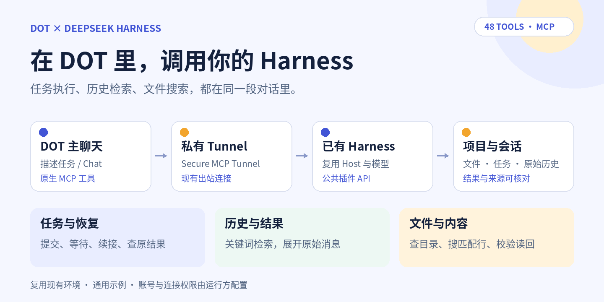
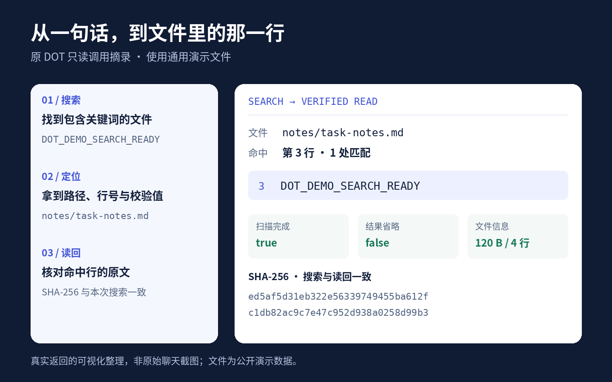

# DOT × DeepSeek Harness

[中文首页](README.md) · **简体中文** · [English](README.en.md) · [安装指南](docs/OPERATIONS.md) · [工具说明](docs/TOOLS.md)

[](https://github.com/xuanmingguo/dot-deepseek-harness-mcp/actions/workflows/ci.yml) · [MIT 许可证](LICENSE)

让 **DOT 主聊天直接操控已有的 DeepSeek Harness**：派任务、查进度、找历史、搜文件，并核对真实结果。复用现有项目、模型与会话，不另起 Harness Host，也不创建 Work/Codex 聊天。



## 可以用它做什么

| 你想做的事 | 它提供的能力 |
|---|---|
| 把任务交给 Harness | 提交任务、查看进度、续接会话、排队、引导和取消，保留原始任务与操作编号 |
| 找回以前做过的工作 | 按项目、会话、状态筛选任务；关键词检索原始历史，展开命中消息及前文 |
| 在项目中找到文件和代码 | 浏览目录、搜索文件内容，返回真实路径、匹配行和片段，再按行或末尾读取 |
| 核对结果与处理断线 | 用文件 SHA-256 校验内容；查询原请求和原生历史，避免不确定时重复派发 |

可以直接在 DOT 中描述目标，例如：

> “找一下这个项目之前做过的分页修复，把原来的结果给我。”
>
> “搜索项目里包含这个关键词的文件，告诉我文件名和具体行号。”
>
> “把这项修改交给 Harness，完成后读回结果并核对文件。”

版本 `0.2.18-dsh021a2.14` 在兼容 Host 中提供 **48 个工具**，已适配 Harness **0.2.1-alpha.2**。实际工具、模型和权限以运行中的 `tools/list` 与 `get_operational_capabilities` 为准。

## 看一次实际搜索与读回

下面使用通用演示文件，展示本轮原 DOT 的真实只读返回：搜索关键词，定位 `notes/task-notes.md` 第 3 行，再用本次命中的 SHA-256 校验读回。



这是**真实返回的可视化整理，并非原始聊天截图**；仅保留相对搜索目录的文件路径和通用内容。[脱敏结果摘录](docs/assets/demo-result.json)可直接查看。演示文件共 4 行，本次只读回命中行，返回的续读位置是第 4 行。

## 它如何连接

```text
DOT 主聊天 → OpenAI Secure MCP Tunnel → 本地 stdio proxy
          → 已有 Harness Host 内的 Relay 插件 → 原生项目、会话与任务
```

基于固定版本的 [Harness Relay MCP](https://github.com/tonytanglab/deepseek-harness-relay-mcp)，通过 Harness 公共插件 API 接入，不修改上游 Harness。固定来源及版本见 [UPSTREAM.json](UPSTREAM.json)。

使用前需要已有 Harness，以及账号、工作空间与 Platform 组织允许的 DOT / 自定义 MCP / Tunnel 权限。开源代码本身不授予这些产品权限。请参考[官方连接说明](https://developers.openai.com/api/docs/guides/secure-mcp-tunnels#connect-from-chatgpt)。

## 从源码开始

需要 Node.js **>=22.19**；CI 使用 pnpm **12.11.2**：

```sh
git clone https://github.com/xuanmingguo/dot-deepseek-harness-mcp.git
cd dot-deepseek-harness-mcp
pnpm install --frozen-lockfile
pnpm run prepack
pnpm test
pnpm run test:package
npm pack --ignore-scripts
```

`prepack` 包含类型检查、构建与包内容校验。最后生成 `harness-relay-mcp-0.2.18-dsh021a2.14.tgz`，按[安装与运维指南](docs/OPERATIONS.md)接入**已有** Harness profile，再配置自己的 Tunnel。

保留上游 npm 包名是为了兼容。**本 fork 尚未发布到 npm**；直接安装 registry 包或运行 `npx harness-relay-mcp` 不会选中这里的修改。

## 文档与验证

| 文档 | 内容 |
|---|---|
| [安装与运维](docs/OPERATIONS.md) | 构建、已有 profile 接入、Tunnel、工具刷新、诊断与回滚 |
| [工具说明](docs/TOOLS.md) · [完整目录](docs/tool-catalog.json) | 输入、输出、权限与恢复约定 |
| [历史搜索](docs/HISTORY_SEARCH.md) · [消息上下文](docs/SESSION_CONTEXT.md) | 找到旧任务后核对原始消息 |
| [目录发现](docs/PROJECT_FILES.md) · [文本读取](docs/PROJECT_TEXT.md) · [内容搜索](docs/PROJECT_SEARCH.md) | 文件查询、范围、扫描覆盖与校验边界 |
| [验证记录与复测方法](docs/ACCEPTANCE.md) | 区分本地测试、已安装插件和原 DOT 实测 |
| [同类项目对照](docs/CAPABILITY_COMPARISON.md) | 功能来源、重合与边界 |

公开版本已通过原生测试、类型/构建/打包与隐私检查；原 DOT 也完成过任务、历史和文件读回验证。具体结果与适用边界见验收文档，持续检查见上方 CI。

## 权限与隐私

`start_run` 缺省为只读。示例保持 `DSH_RELAY_TRUSTED_OPERATOR=false`；文件范围属于任务指令与准入校验，不是 OS 逐路径隔离。需要写入或部署时，按实际授权明确指定范围与权限，详见[权限约定](docs/TOOLS.md#权限选择与默认值)和[部署契约](docs/DEPLOYMENT.md)。

项目不提供模型凭据或订阅。Token、Tunnel 配置、原聊天历史、任务 journal、个人路径、备份和原始回执留在私有环境。发生超时或断线，先查原 `runId` / `operationId`，不要换键重派。

## 许可与贡献

采用 **MIT**；保留上游 [LICENSE](LICENSE) 与固定来源，维护归属见 [NOTICE](NOTICE)。这是独立维护的集成，不代表 OpenAI 或 DeepSeek 官方支持。

欢迎提供可复现的问题与改进，提交前请移除个人信息。见 [贡献说明](CONTRIBUTING.md)与[安全报告](SECURITY.md)。图示提供 PNG 与可编辑 SVG，均使用通用展示内容。
